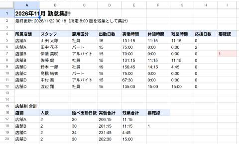
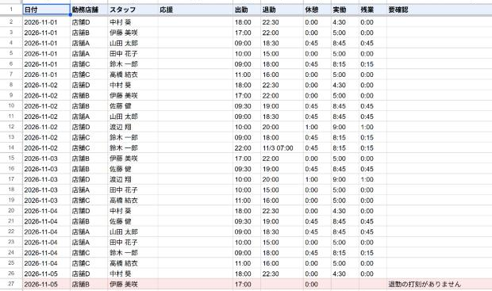
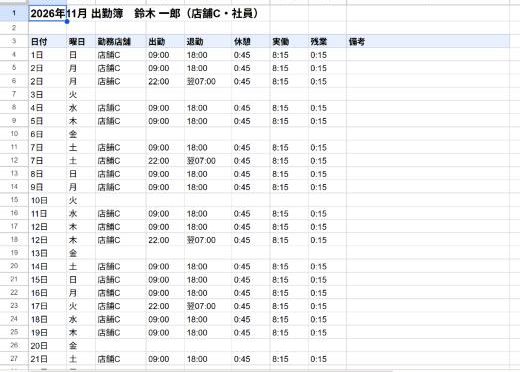

# 🕒 Googleフォーム × スプレッドシート 勤怠管理（GAS）

複数店舗の出退勤を **Googleフォームで打刻** し、**スプレッドシートで自動集計** する勤怠管理です。
専用システムの契約は不要で、Google アカウントの中だけで動きます。



## できること

| 機能 | 内容 |
|---|---|
| 打刻 | フォームで「店舗・スタッフ名・出勤／休憩開始／休憩終了／退勤」を選んで送信。打刻時刻は自動記録 |
| 勤務時間の自動計算 | 実働・休憩（複数回の休憩も合計）・残業（1日の所定時間を超えた分。設定で変更可） |
| 夜勤（日またぎ） | 22:00〜翌7:00 のような勤務も出勤日の勤務として計算（休憩45分なら実働 8:15） |
| 応援勤務 | 所属と違う店舗で出勤すると「応援」として記録・集計 |
| 打刻漏れの検出 | 退勤忘れ・休憩終了忘れ・出勤なしの退勤を「要確認」として赤く表示 |
| 月次集計 | スタッフ別（出勤日数・実働・休憩・残業・応援日数・要確認）と店舗別の合計 |
| 月間出勤簿 | スタッフを選ぶと、その月の出勤簿シートを作成（印刷用） |

### 日次（夜勤・打刻漏れの表示）


### 月間出勤簿


## 工夫した点

- **勤怠計算を純粋関数に分離**（`src/Logic.gs`）し、Node.js で単体テスト。夜勤・応援・打刻漏れ・休憩中の退勤・打刻順の入れ替わりなど 14 ケース
- **Google のサービスを模擬したスモークテスト**で、セットアップ〜集計〜出勤簿までを通しで検証
- **実環境で見つけた落とし穴に対応**
  - 「131:15」のような時間の合計が、スプレッドシートに時刻と解釈されて「11:15」に化ける → 文字列書式で書き込み
  - 列幅の自動調整が日本語で狭くなる → 固定幅
- 同時打刻で集計が競合しないよう `LockService` で直列化

## 使い方

### clasp で入れる
```bash
clasp create --type sheets --title "勤怠管理" --rootDir src
clasp push
```

### 貼り付けで入れる
1. 新しいスプレッドシート →「拡張機能 > Apps Script」
2. `dist/all-in-one.gs` の中身を「コード.gs」に貼り付けて保存

### 初回
1. エディタで `setup` を実行（権限を許可）→ 打刻フォーム・スタッフシートが作られ、トリガーが登録される
2. 「スタッフ」シートに氏名・所属店舗・雇用区分を入力 → メニュー「🕒 勤怠管理 > フォームのスタッフ一覧を更新」
3. 動作を見たいときは「（デモ）サンプル打刻を投入」

店舗名や所定労働時間は `src/Main.gs` の `CONFIG` で変更できます。

## テスト

```bash
npm test
```

## ファイル構成

```
src/
  Logic.gs        勤怠計算（打刻→勤務、月次集計、店舗別集計）
  Main.gs         メニュー・セットアップ・シート出力・出勤簿・デモデータ
  appsscript.json
test/
  logic.test.js   勤怠計算の単体テスト
  smoke.test.js   Google のサービスを模擬した通しテスト
dist/all-in-one.gs  貼り付け用の1ファイル版
docs/             スクリーンショット
```

## ライセンス

MIT
